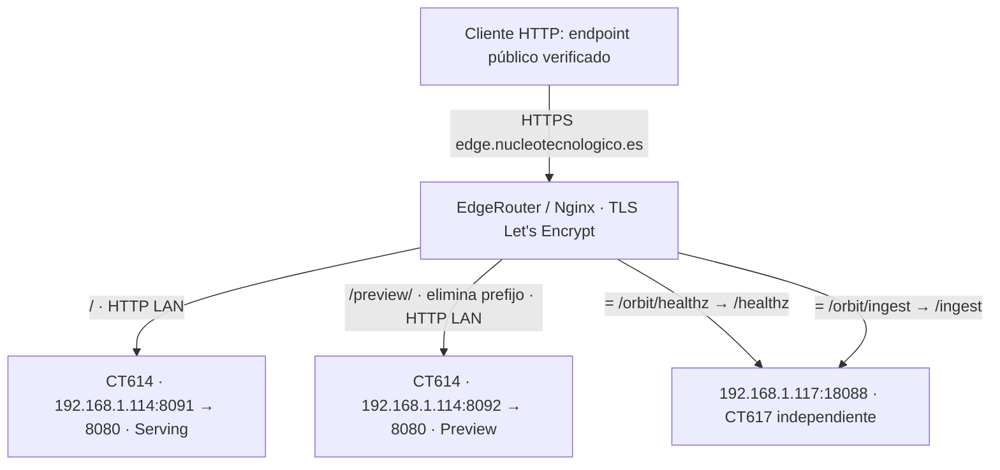

# CT 614 — infra-nucleoedge: inventario técnico individual

Ficha principal del servicio. Verificación: **06/11/2026, 23:07 CET**
(22:07 UTC en las evidencias). Los datos observados son una captura, no una
promesa de estado permanente. Production, propósito y dominio principal fueron
confirmados por el propietario; recursos, runtime y rutas se contrastaron por lectura.

Fuentes: [observación CT614/Nginx/DNS/TLS](../roadmap/evidence/2026-11-06-d047-614-discovery.json),
[configuración y métricas de monitorización](../roadmap/evidence/2026-11-06-d047-614-monitoring.json),
[inventario IaC](../../inventory/services/infra-nucleoedge.yml),
[diagnóstico D043](../roadmap/CT614-SGTM-D043.md) y
[recuperación D044](../roadmap/CT614-SGTM-D044-RECOVERY.md).
No se consultó CT617: su destino se documenta únicamente desde Nginx.

## A. General Information

| Campo | Valor y procedencia |
|---|---|
| CT ID / Name | 614 / infra-nucleoedge; Proxmox observado |
| Proxmox Node | pve |
| Private IP | 192.168.1.114/24 |
| Environment | Production; confirmado por propietario |
| Service | Google Tag Manager Server-Side (sGTM) |
| Main Website | https://nucleotecnologico.es; asociación confirmada por propietario |
| Public Endpoint | https://edge.nucleotecnologico.es |
| Infrastructure | Proxmox LXC + Docker + Nginx reverse proxy en EdgeRouter |
| CPU | 2 cores asignados; métrica LXC de capacidad = 2 |
| RAM / swap | 2048 MiB / 512 MiB asignados |
| Almacenamiento observado | rootfs `local-lvm:vm-614-disk-0,size=10G` (capacidad asignada, no espacio libre) |
| Almacenamiento declarado | 16 GiB en YAML; discrepancia sin corregir |
| OS del LXC | Ubuntu 22.04.5 LTS (Jammy); no confundir con Alpine del contenedor cAdvisor |
| Docker Engine / Compose | 29.1.3 / 5.0.0 observados |
| Red | bridge vmbr0; gateway 192.168.1.254; firewall de interfaz habilitado |

## B. Purpose

Server-Side Google Tag Manager permite que solicitudes de medición lleguen a un
contenedor servidor, donde clientes, variables, activadores y etiquetas definen
cómo interpretarlas y procesarlas. CT614 proporciona el runtime de ese servicio
para Núcleo Tecnológico, detrás de un subdominio propio. Serving atiende solicitudes;
Preview permite depurar la configuración del contenedor GTM.

El flujo previsto es sitio web → endpoint de tracking → cliente GTM servidor →
eventos/etiquetas configurados → destino, por ejemplo GA4. La función del servidor
está confirmada por Compose e imagen. **La configuración del navegador y la entrega
real a GA4 no se verificaron**: no se inspeccionaron un workspace/export de GTM ni
los datos de Analytics, y no se enviaron eventos de prueba.

Aceptar HTTP, devolver 200 o tener un cliente GA4 configurado no certifica que
las etiquetas se disparen ni que Analytics reciba eventos. [Documentación oficial
de sGTM](https://developers.google.com/tag-platform/tag-manager/server-side).

## C. Applications and Components

| Application | Docker Container | Puerto publicado → interno | Purpose / estado observado |
|---|---|---|---|
| sGTM Serving | infra-nucleoedge-sgtm-1 | 8091 → 8080/tcp | Procesamiento de tracking; running, healthy |
| sGTM Preview | infra-nucleoedge-sgtm_preview-1 | 8092 → 8080/tcp | Depuración GTM; running, healthy |
| Node Exporter | node_exporter | 192.168.1.114:9100 → 9100/tcp | Métricas del LXC; running, target UP |
| cAdvisor | cadvisor | 192.168.1.114:8085 → 8080/tcp | Métricas por contenedor Docker; running, healthy, target UP |

Serving/Preview usan `gcr.io/cloud-tagging-10302018/gtm-cloud-image:stable` con digest
real común `sha256:16c407168e2089ef6ed6a43253be1294a2bf693dbdef98e05283ef1299dff8ba`.
**Versión semántica de sGTM: no verificada**; `stable` no es una versión. El bootstrap
remoto puede cambiar aunque se conserve la imagen. Ambos servicios carecen de
montajes de datos observados; la configuración privada no debe publicarse.

Node Exporter **1.10.2**, confirmado por `node_exporter_build_info`; imagen
`prom/node-exporter@sha256:3ac34ce007accad95afed72149e0d2b927b7e42fd1c866149b945b84737c62c3`.
cAdvisor **v0.60.6**, confirmado por `cadvisor_version_info`; imagen
`ghcr.io/google/cadvisor@sha256:b8e7d1093144fd088f425ff003d75a4aa405de075db78dae3bc563730b1bd07a`.
Los originales detenidos de exporters se conservan para recuperación; no son servicios
activos ni deben reactivarse automáticamente.

## D. Confirmed Architecture

Las conexiones públicas llegan a Nginx en EdgeRouter, que escucha 80 y 443.
TLS termina allí con certificado de Let's Encrypt. Desde Nginx al backend se usa
HTTP sobre la LAN, no TLS. Las rutas exactas se leyeron del vhost activo:

| Location Nginx | Destino real | Pertenencia |
|---|---|---|
| `/` | `http://192.168.1.114:8091` | CT614 Serving; atiende rutas no capturadas por locations más específicas |
| `^~ /preview/` | `http://192.168.1.114:8092` | CT614 Preview; `rewrite ^/preview/(.*)$ /$1 break` |
| `= /orbit/healthz` | `http://192.168.1.117:18088/healthz` | CT617, servicio independiente |
| `= /orbit/ingest` | `http://192.168.1.117:18088/ingest` | CT617, servicio independiente |

`/preview/healthz` público se convierte en `/healthz` del backend Preview.
`/orbit/*` no identifica todo un prefijo de CT617: se confirmaron **dos locations
exactas**. No atribuir esas solicitudes, métricas o fallos a CT614 por compartir
el dominio. Tampoco asumir que cualquier ruta `/orbit/otra` usa CT617.



El diagrama representa conexiones/rutas confirmadas, no entrega de eventos GA4.
El sitio `nucleotecnologico.es` es el origen previsto de tracking; su configuración
web → servidor y el tramo servidor → GA4 permanecen fuera de la verificación.
Serving tiene `depends_on` de Preview y URL pública de Preview coincidente con el
vhost. Preview tiene modo de depuración habilitado; ambos comparten la misma
configuración GTM privada. La estructura se revisó sin publicar sus valores.

## E. Network and DNS

- Dominio principal: `nucleotecnologico.es`; tracking: `edge.nucleotecnologico.es`.
- DNS A observado: **79.156.8.245**, resuelto de nuevo el 06/11/2026; no reutilizado
  de una observación histórica. Registro AAAA y reglas NAT del router no auditados.
- CT614: 192.168.1.114/24. Serving/Preview publican 8091/8092 y escuchan 8080 dentro
  de sus respectivos contenedores. Exporters: 9100 y **8085**, acceso LAN.
- Nginx: `/etc/nginx/sites-enabled/edge.nucleotecnologico.es.conf` en EdgeRouter.
- Certificado: `/etc/letsencrypt/live/edge.nucleotecnologico.es/fullchain.pem`.
  Emisor observado Let's Encrypt YR2; vigencia 02/11/2026 19:44:49 UTC a
  31/01/2027 19:44:48 UTC. CA y hostname se validaron sin desactivar TLS.
- Renovación automática del certificado: no comprobada; no asumirla por la ruta
  del archivo. No se leyeron ni copiaron claves privadas.
- Acceso público depende de DNS, TLS y Nginx; arranque/actualización de configuración
  de GTM depende de conectividad a Google. Salud pública 200 no prueba la regla NAT
  exacta ni que los puertos del backend estén correctamente aislados de Internet.

## F. Configuration and Infrastructure as Code

Rutas de repositorio relativas a `terraform/proxmox/`, salvo indicación contraria:

| Elemento | Repositorio | Producción observada |
|---|---|---|
| Recurso LXC | `main.tf`: `proxmox_virtual_environment_container.svc["infra-nucleoedge"]`; `inventory.tf` | nodo pve, CT614 |
| Inventario | `inventory/services/infra-nucleoedge.yml` y `inventory/defaults.yml` | Proxmox config; diferencias de disco documentadas |
| Aplicación histórica | `services/infra-nucleoedge/compose/docker-compose.yml` | **No es la base activa equivalente** |
| Base Compose real | Referencia privada preservada en backups D044 | `/opt/infra-nucleoedge/docker-compose.yml` |
| Overlay healthcheck | `services/infra-nucleoedge/proposals/d043/healthcheck.native.yml` | `/opt/infra-nucleoedge/healthcheck.native.yml` |
| Exporters | `services/common/node-exporter/docker-compose.phase4.yml`, `services/common/cadvisor/docker-compose.phase4.yml`, procedimiento F4 | `/opt/exporter-phase4-pilot/integration-20261106T191534614Z-614/`; rutas exactas en labels Compose de evidencia |
| Nginx | Vhost activo confirmado por lectura; ruta equivalente versionada **no confirmada** | EdgeRouter: `/etc/nginx/sites-enabled/edge.nucleotecnologico.es.conf` |
| Prometheus | `services/infra-prom/config/prometheus.yml`, `config/targets/` y `config/rules/` | CT610: `/opt/infra-prom/config/`; montado en `/etc/prometheus/` |
| Blackbox | `services/infra-blackbox/config/blackbox.yml` | CT616: `/opt/infra-blackbox/config/blackbox.yml` → `/etc/blackbox/blackbox.yml` |
| Notes | `services/infra-nucleoedge/NOTES.md`, plantilla `templates/lxc-notes.tftpl`, generador e inventario | Campo description; procedimiento [NOTES-IAC](../../services/infra-nucleoedge/NOTES-IAC.md) |

**Discrepancias sin corregir:** disco declarado 16 GiB frente a 10G asignados;
Compose histórico con 8093/8094 y distinta URL Preview, frente a 8091/8092 activos.
D043 validó que el overlay solo cambia healthchecks sobre la **base activa**.
No ejecutar despliegues con el Compose histórico ni copiar secretos al repositorio.

Las labels observadas de Prometheus difieren parcialmente de los JSON locales:
Node usa `vmid="614"` y `cpu_contract`; cAdvisor no expone `ct_id` ni `vmid` en
`up`. Por ello `up{ct_id="614"}` vacío **no significa caída**. Usar el selector
`service="infra-nucleoedge"`. La configuración local y activa de Prometheus tiene
otras diferencias históricas fuera del alcance: no se sincronizó globalmente.

## G. Dependencies

**Operativas:** Proxmox/LXC y almacenamiento local-lvm, Docker/Compose, red interna,
EdgeRouter/Nginx, resolución DNS, certificado Let's Encrypt y configuración/runtime
de Google Tag Manager. Serving depende de Preview según Compose. La disponibilidad
actual de sus endpoints está confirmada; las garantías de cada servicio externo y
la gestión de credenciales GTM no fueron auditadas.

**De observabilidad, no del procesamiento de tracking:** Node Exporter y cAdvisor
producen métricas; Prometheus las recoge/evalúa; Blackbox realiza probes HTTP;
Alertmanager enruta alertas hacia Telegram. Una caída de estas herramientas puede
ocultar problemas sin implicar que Serving haya dejado de procesar solicitudes.
No se ha demostrado dependencia operativa de CT614 respecto a CT617.

## H. Monitoring and Health Checks

- Prometheus: `http://192.168.1.110:9090`, scrape/evaluación global 30s.
  Targets de CT614 Node y cAdvisor UP y `up=1` al verificar.
- Node: `http://192.168.1.114:9100/metrics`. CPU usa contrato cgroup LXC y textfile
  `lxc_cpu_*`; collector CPU físico desactivado. No restaurar fórmulas de CPU host.
- cAdvisor: `http://192.168.1.114:8085/metrics`; métricas individuales Docker,
  housekeeping configurado a 30s. La versión Alpine de su métrica es la imagen,
  no el sistema operativo del LXC.
- Blackbox: `http://192.168.1.116:9115/probe`, módulo activo `http_collect_200`,
  método **HEAD**, timeout 10s, TLS verificado, sin redirects, HTTP 200/204 aceptados.
  Sondas `nucleo-collect-blackbox` y `nucleo-collect-local-client`; ambas sondean
  el endpoint público `/g/collect`, no son prueba de acceso directo a backend.
  Sus parámetros se omiten aquí para no divulgar identificadores ni disparar eventos.
- Labels de esas sondas: `service="edge-nucleotecnologico-collect"`, diferente
  del service de exporters. Ambas `probe_success=1`, HTTP200 en la captura.
- Regla activa `CollectEndpointDown`, `for: 2m`, en
  `/opt/infra-prom/config/rules/blackbox-alerts.yml`. No había serie ALERTS activa
  para esos selectores. No se ensayó el `for` ni un nuevo FIRING/RESOLVED.
- Alertmanager/Telegram: canal documentado D041/D044; no se abrió configuración
  secreta ni se envió mensaje de prueba en esta tarea. Disponibilidad puntual de
  Alertmanager y recepción humana de Telegram no se certifican por `up` de CT614.

El check antiguo ejecutaba curl, ausente en la imagen mínima, contra `/`.
Ahora Docker ejecuta `/nodejs/bin/node /app/health_checker_bin.js`, que consulta
GET `/healthz`: intervalo 30s, timeout 10s, 3 intentos, start_period 30s (D044).
No instalar curl ni shell dentro de la imagen para diagnosticarla.

| Endpoint de salud | Resultado observado |
|---|---|
| `http://192.168.1.114:8091/healthz` (Serving) | HTTP200 |
| `http://192.168.1.114:8092/healthz` (Preview) | HTTP200 |
| `https://edge.nucleotecnologico.es/healthz` | HTTP200 |
| `https://edge.nucleotecnologico.es/preview/healthz` | HTTP200 |

HTTP200 sin cabeceras especiales confirma el criterio nativo de salud del runtime
en ese instante. **No garantiza cliente/tag GA4 correcto, consentimiento, triggers,
publicación GTM, recepción en Analytics ni ausencia de pérdida de eventos.** Las
sondas collect no cubren toda la salud del bootstrap. Los checks nativos adicionales
Blackbox propuestos en D043 siguen diferidos, no instalados. `/` no es un endpoint
de liveness: sus 400/404 históricos no demuestran por sí solos una caída.

## I. Known Issues and Recovery

El 06/11/2026 ambos contenedores figuraban unhealthy: el healthcheck Docker era
incompatible y, además, el runtime devolvía 503 en `/healthy` y `/healthz`.
D043 atribuyó con alta confianza el segundo fallo a la caducidad del bootstrap
cargado al arrancar tras unos 50 días. No fue solo un falso positivo de Docker.

D044 aplicó el checker Node mediante overlay, preservando imagen, configuración,
secretos, puertos y recursos. Se validó Preview antes del principal; ambos acabaron
healthy con HTTP200 local/público. Hubo **7 recreaciones Preview y 4 Serving**,
incluidos rollbacks: errores corregidos de import, equivalencia DNS vacío,
muestra Blackbox retenida e identidad/alcance histórico del intento. No ocultar
esas interrupciones ni deducir ausencia de recreaciones de RestartCount=0.

No hay prevención automática instalada. Reinicios periódicos son una propuesta
que requiere revisar interrupción del servicio, dependencia de Google y bucles.
Entrega GA4 y prevención pendientes en [Issue #1](https://github.com/eduardo152030/mailerblend-platform-infra/issues/1).
Consultar [D043](../roadmap/CT614-SGTM-D043.md) y [D044](../roadmap/CT614-SGTM-D044-RECOVERY.md)
antes de cualquier intervención; no repetir automáticamente su recuperador.

## J. Operations and Troubleshooting

### Diagnóstico de solo lectura

Los comandos `pct` siguientes se ejecutan **en pve tras verificar su identidad SSH**.
Usar los accesos existentes con `StrictHostKeyChecking=yes`,
`UserKnownHostsFile=$HOME/.ssh/known_hosts` y `BatchMode=yes`; no desactivar TLS/SSH.
No ejecutar comandos de otros CT, salvo las dependencias expresamente indicadas.

```bash
pct status 614
pct exec 614 -- docker ps --format 'table {{.Names}}\t{{.Image}}\t{{.Status}}\t{{.Ports}}'
pct exec 614 -- docker inspect --format '{{.Name}} {{.State.Status}} {{.State.Health.Status}} restarts={{.RestartCount}}' infra-nucleoedge-sgtm-1 infra-nucleoedge-sgtm_preview-1
pct exec 614 -- docker port infra-nucleoedge-sgtm-1
pct exec 614 -- docker port infra-nucleoedge-sgtm_preview-1
pct exec 614 -- ss -lnt
pct exec 614 -- docker exec infra-nucleoedge-sgtm-1 /nodejs/bin/node /app/health_checker_bin.js
pct exec 614 -- docker exec infra-nucleoedge-sgtm_preview-1 /nodejs/bin/node /app/health_checker_bin.js
```

Desde pve o una estación con acceso LAN, usando curl del **host**, no de la imagen:

```bash
curl -fsS -o /dev/null -w '%{http_code}\n' http://192.168.1.114:8091/healthz
curl -fsS -o /dev/null -w '%{http_code}\n' http://192.168.1.114:8092/healthz
curl -fsS -o /dev/null -w '%{http_code}\n' https://edge.nucleotecnologico.es/healthz
curl -fsS -o /dev/null -w '%{http_code}\n' https://edge.nucleotecnologico.es/preview/healthz
curl -fsS http://192.168.1.114:9100/metrics | rg '^node_exporter_build_info|^lxc_cpu_capacity_cores'
curl -fsS http://192.168.1.114:8085/metrics | rg '^cadvisor_version_info'
curl -fsSG http://192.168.1.110:9090/api/v1/query --data-urlencode 'query=up{service="infra-nucleoedge"}'
curl -fsSG http://192.168.1.110:9090/api/v1/query --data-urlencode 'query=probe_success{service="edge-nucleotecnologico-collect"}'
curl -fsSG http://192.168.1.110:9090/api/v1/query --data-urlencode 'query=ALERTS{service=~"infra-nucleoedge|edge-nucleotecnologico-collect"}'
```

En las respuestas de Prometheus comprobar series, etiquetas y timestamps; vacío no
es cero. No reutilizar manualmente el payload de collect ni lanzar GET de eventos.
Para rutas, desde pve, únicamente el vhost relacionado (salida sin claves):

```bash
pct exec 109 -- grep -nE 'server_name|listen|location|proxy_pass|rewrite|ssl_certificate ' /etc/nginx/sites-enabled/edge.nucleotecnologico.es.conf
```

Logs: limitarlos y guardarlos privados, no pegarlos íntegros en chat ni en Git.
Estos comandos leen Docker; solo escriben evidencias locales de diagnóstico en pve:

```bash
umask 077
mkdir -p "$HOME/.local/share/ct614-diagnostics"
pct exec 614 -- docker logs --since 10m --tail 100 infra-nucleoedge-sgtm-1 > "$HOME/.local/share/ct614-diagnostics/serving.log" 2>&1
pct exec 614 -- docker logs --since 10m --tail 100 infra-nucleoedge-sgtm_preview-1 > "$HOME/.local/share/ct614-diagnostics/preview.log" 2>&1
```

Revisar localmente mensajes de arranque/errores y redactar valores antes de compartir.
No volcar `docker inspect` completo, Compose resuelto, entornos ni CONTAINER_CONFIG.

### Intervenciones que modifican producción

No forman parte del diagnóstico. No incluir reinicios/recreaciones rutinarios ni
aplicar el Compose histórico. Una recuperación requiere autorización, backup,
revisión de D044 y Preview saludable antes de Serving. El cambio de Notes sigue
su plan Terraform exclusivo de description, sin tags ni otros recursos.

## K. Backup and Recovery

D044 respaldó Compose activo, configuración efectiva/inspecciones privadas y la
imagen original. No es una política de snapshots completos del LXC. Los datos
privados deben conservar permisos restrictivos y no versionarse. No hay montajes
de datos en sGTM observados; ello no elimina la necesidad de preservar configuración.

Copias D044 verificadas por existencia y tamaño en esta tarea (119859200 bytes):

- CT614: `/opt/infra-nucleoedge/.runtime/sgtm-614-d044-20261106T211738Z/backup.tar`.
- pve: `/mnt/storage/mailerblend-recovery/sgtm-614-d044-20261106T211738Z/backup.tar`.
- Operador: `~/.local/share/mailerblend-recovery/sgtm614/sgtm-614-d044-20261106T211738Z/backup.tar`.

SHA256 registrado/verificado durante D044:
`776a8c4a69506d0f4e190dd08ee44c283568e30ffc073f9b13293f8fb39ffcb9`.
No se recalculó ni ensayó restauración en D047. D044 verificó archivo, miembros,
imagen y copias; ejecutó recuperación de configuración durante sus reintentos.
Eso no equivale a haber restaurado funcionalmente un backup completo del LXC.

Comprobación de existencia/tamaño, desde pve y operador respectivamente:

```bash
stat -c '%n %s bytes' /mnt/storage/mailerblend-recovery/sgtm-614-d044-20261106T211738Z/backup.tar
pct exec 614 -- stat -c '%n %s bytes' /opt/infra-nucleoedge/.runtime/sgtm-614-d044-20261106T211738Z/backup.tar
stat -c '%n %s bytes' "$HOME/.local/share/mailerblend-recovery/sgtm614/sgtm-614-d044-20261106T211738Z/backup.tar"
```

Conservar la base activa, overlay, configuración GTM privada, imagen por digest,
puertos y URL Preview. El backup original incluye el checker curl defectuoso:
restaurar solo esa base no constituye el estado final saludable. D044 explica
cómo recuperar con la imagen local y validar salud; no publica secretos.

Riesgos de recreación: interrupción en instancia única Serving y posible pérdida
de solicitudes no cuantificada, pérdida de sesiones Preview, dependencia del
bootstrap/configuración que Google entregue al arrancar, y cambio de código remoto
pese al digest Docker fijo. No automatizar por la presencia de este runbook.

## L. Known Limitations / Pending Verification

1. Flujo real navegador → GTM servidor → GA4: cliente, etiquetas, consentimiento,
   triggers, publicación y recepción en Analytics pendientes; no eventos enviados.
2. Prevención de caducidad y alertas nativas `/healthz`: propuestas, no implementadas.
3. Compose del repositorio no coincide con base activa; Nginx versionado equivalente
   no confirmado. No se corrigieron esas discrepancias ni el disco 16/10 GiB.
4. Publicación estable `stable` no identifica versión semántica ni fija bootstrap.
5. Reglas NAT/firewall completas, AAAA, renovación ACME y continuidad de servicios
   externos no auditados. La salud observada no garantiza disponibilidad futura.
6. Recepción humana de Telegram y prueba GA4 controlada requieren verificación
   específica; no se ejercitó una alerta nueva ni un período `for` en esta tarea.
7. Propietario operativo, repositorio de código de aplicación independiente y política
   completa de backup/retención siguen pendientes de documentación.

Ficha mantenida en el repositorio IaC. Actualizar fecha y evidencias al cambiar
producción, no inferir cambios por tags de imágenes ni convertir datos ausentes en cero.
