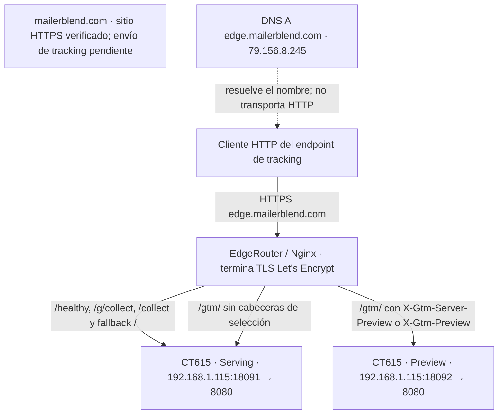

# CT 615 — infra-mailerblend-edge: inventario técnico individual

Ficha principal del servicio de tracking de Mailerblend. Verificado por lectura
el **06/11/2026, 23:27 CET**; las evidencias conservan sus marcas UTC. Captura de
estado, no garantía futura. Se consultaron CT615 y sus dependencias directas
Nginx/Prometheus/Blackbox/DNS. No se repitieron validaciones extensas de Fase4.

Fuentes: [Proxmox/runtime/Nginx/DNS/TLS](../roadmap/evidence/2026-11-06-d049-615-discovery.json),
[monitorización y backups](../roadmap/evidence/2026-11-06-d049-615-monitoring.json),
[sitio público y readiness](../roadmap/evidence/2026-11-06-d049-615-public-site.json),
[recuperación D048](../roadmap/CT615-SGTM-D048-RECOVERY.md),
[inventario declarado](../../inventory/services/infra-mailerblend-edge.yml).

## A. General Information

| Campo | Valor / verificación |
|---|---|
| CT ID / hostname | 615 / infra-mailerblend-edge; Proxmox |
| Nodo / estado | pve / running |
| Entorno | Production: clasificación `prod` en YAML y tags PVE |
| IP privada | 192.168.1.115/24 |
| Propósito | Runtime Google Tag Manager Server-Side para Mailerblend |
| Dominio principal | mailerblend.com; DNS y sitio HTTPS200 verificados, título “MailerBlend - Email & SMS Marketing Platform” |
| Endpoint público | https://edge.mailerblend.com; DNS, TLS, vhost y salud verificados |
| Infraestructura | Proxmox LXC + Docker; proxy Nginx en EdgeRouter |
| CPU / RAM / swap | 2 cores / 2048 MiB / 512 MiB asignados |
| Disco real | `local-lvm:vm-615-disk-0,size=10G` (asignación, no espacio libre) |
| Disco declarado | 16 GiB; discrepancia no corregida |
| OS del LXC | Ubuntu 22.04.5 LTS (Jammy) |
| Docker Engine / Compose | 29.1.3 / 5.0.0 |
| Red | vmbr0; gateway192.168.1.254; firewall de interfaz habilitado |
| Tags observados | `192.168.1.115;infra;mailerblend;prod;sgtm`, sin cambios |

## B. Purpose

CT615 proporciona el servicio de medición del lado servidor bajo el dominio de
Mailerblend. Recibe solicitudes de tracking en el endpoint `edge.mailerblend.com`
y las entrega al runtime de un contenedor servidor de Google Tag Manager. En ese
runtime, los clientes interpretan solicitudes y las etiquetas/activadores/variables
determinan su procesamiento y eventual envío a destinos externos.

La separación permite operar el receptor de tracking bajo un dominio propio y
procesar datos antes de remitirlos a proveedores de medición. Este es el papel de
la infraestructura observada; **no se ha verificado qué transformaciones, reglas,
consentimientos u objetivos comerciales concretos tiene publicados Mailerblend**.
El sitio principal es una plataforma de email/SMS según su página pública; no
inferir que CT615 envía emails/SMS ni que sus eventos cubren conversiones concretas.

Serving es el backend que procesa solicitudes habituales de medición. Preview es
el backend de depuración del contenedor GTM, utilizado para inspeccionar su
comportamiento durante pruebas. No sustituye Serving ni demuestra por sí mismo
que GA4 haya recibido eventos.

**Entrega GA4 extremo a extremo: pendiente.** No se accedió al workspace/export
GTM, no se ejecutó JavaScript del sitio y no se enviaron eventos analíticos. El HTML
inicial consultado no contenía `edge.mailerblend.com`; esto tampoco demuestra que
el navegador no lo use, porque puede configurarlo dinámicamente.
[Referencia conceptual de Google](https://developers.google.com/tag-platform/tag-manager/server-side).

## C. Applications and Components

| Aplicación | Contenedor Docker real | Imagen / versión comprobada | Publicado → interno | Función / estado |
|---|---|---|---|---|
| sGTM Serving | mailerblend-sgtm-serving | gcr.io/cloud-tagging-10302018/gtm-cloud-image:stable | 18091 → 8080/tcp | Tracking, running/healthy |
| sGTM Preview | mailerblend-sgtm-preview | misma imagen | 18092 → 8080/tcp | Depuración, running/healthy |
| Node Exporter | node_exporter | prom/node-exporter, 1.10.2 por build_info | 192.168.1.115:9100 → 9100/tcp | Métricas LXC, running; up1 |
| cAdvisor | cadvisor | ghcr.io/google/cadvisor, v0.60.6 por version_info | 192.168.1.115:8085 → 8080/tcp | Métricas Docker, running/healthy; up1 |

Serving/Preview tienen imagen idéntica por digest:
`sha256:16c407168e2089ef6ed6a43253be1294a2bf693dbdef98e05283ef1299dff8ba`.
**Versión semántica sGTM no verificada:** `stable` no es una versión y no fija el
bootstrap remoto que Google sirve al arrancar.

Digest Node Exporter:
`sha256:3ac34ce007accad95afed72149e0d2b927b7e42fd1c866149b945b84737c62c3`;
cAdvisor: `sha256:b8e7d1093144fd088f425ff003d75a4aa405de075db78dae3bc563730b1bd07a`.
No confundir Alpine de la imagen cAdvisor con Ubuntu del LXC.

Serving/Preview **sin mounts de datos observados**; su configuración efectiva es
privada. cAdvisor monta interfaces de Docker/containerd y rutas del host en lectura;
Node monta `/` como `/host` y el script CPU cgroup. No modificar esos inputs F4.
Se conservan detenidos `cadvisor-pre-phase4-615` y `node_exporter-pre-phase4-615`;
no reactivarlos ni considerarlos servicios activos o backups completos por sí solos.

## D. Confirmed Architecture

El dominio principal y el dominio de tracking existen, pero no se verificó el tramo
**navegador del sitio → endpoint de tracking**. DNS resuelve el endpoint a la IP
pública observada; el cliente HTTPS llega al Nginx de EdgeRouter, que termina TLS.
Desde allí las conexiones al LXC usan HTTP por la LAN.

Upstreams confirmados en el vhost activo:

- `sgtm_serving`: `192.168.1.115:18091`.
- `sgtm_preview`: `192.168.1.115:18092`.

| Location | Enrutamiento configurado |
|---|---|
| `= /healthy` | sgtm_serving |
| `^~ /g/collect` | sgtm_serving |
| `^~ /collect` | sgtm_serving |
| `^~ /gtm/` | Preview si alguna cabecera de selección no está vacía; Serving en caso contrario |
| `/` | sgtm_serving; incluye `/healthz` |
| `/.well-known/acme-challenge/` | Validación ACME del proxy; no aplicación CT615 |

En `/gtm/`, `$use_preview` inicia en0. Nginx lo cambia a1 si
`X-Gtm-Server-Preview` **o** `X-Gtm-Preview` no están vacías, y selecciona el upstream
correspondiente. No se observó rewrite de prefijo en esa location. **No copiar el
esquema `/preview/` de CT614.** `PREVIEW_SERVER_URL` de Serving es
`https://edge.mailerblend.com`; Preview tiene `RUN_AS_PREVIEW_SERVER=true`.
Ambos comparten configuración GTM estructuralmente válida (D048), sin publicar valores.
Compose declara `sgtm` dependiente de `sgtm_preview`; esto no demuestra todos los
intercambios internos de depuración ni todas las rutas de la UI Preview.



Las flechas de tráfico representan rutas configuradas y comprobaciones de salud,
no eventos GA4. El sitio aparece sin flecha hacia tracking porque ese enlace no se
probó. No se dibuja una conexión a GA4 u otro receptor externo sin evidencia de
entrega. Google es una dependencia configurada del runtime/bootstrap, no un destino
analítico funcionalmente certificado. NAT exacto y todos los intermediarios de red
no fueron auditados; salud pública correcta no sustituye esa auditoría.

## E. Network and DNS

- Dominio principal verificado: `mailerblend.com`, HTTPS200; DNS A observado
  `108.157.128.12`, `108.157.128.33`, `108.157.128.42` y `108.157.128.106`.
  No asumir que el sitio principal está alojado en CT615.
- Tracking: `edge.mailerblend.com`, A **79.156.8.245** resuelto de nuevo en D049.
  No se comprobaron AAAA ni otros subdominios; no inventar URL Preview independiente.
- Backend LAN: `192.168.1.115/24`, Serving18091/Preview18092 hacia8080/tcp.
  Exporters9100/8085; accesibilidad pública directa de esos puertos no auditada.
- Nginx EdgeRouter: escucha80/443, vhost
  `/etc/nginx/sites-enabled/edge.mailerblend.com.conf`.
- Certificado: `/etc/letsencrypt/live/edge.mailerblend.com/fullchain.pem`;
  Let's Encrypt **YR1**, válido del12/09/2026 14:51:08 UTC al11/12/2026 14:51:07 UTC.
  CA y hostname verificados. No se inspeccionaron claves privadas.
- Renovación automática ACME, reglas NAT/firewall completas y continuidad DNS:
  pendientes. La location ACME y un certificado válido no prueban su renovación futura.

## F. Infrastructure as Code

Rutas de repositorio relativas a `terraform/proxmox/`:

| Elemento | Fuente declarada | Estado desplegado / ruta real |
|---|---|---|
| Recurso LXC | `main.tf`, `inventory.tf`; `proxmox_virtual_environment_container.svc["infra-mailerblend-edge"]` | pve/615 |
| Inventario | `inventory/services/infra-mailerblend-edge.yml`, `inventory/defaults.yml` | 2CPU/2048MiB/512MiB; disco real10G frente a16GiB declarado |
| Compose del repo | `services/infra-mailerblend-edge/compose/docker-compose.yml` | Mismos puertos declarados18091/18092, pero healthcheck curl histórico |
| Compose activo | Base privada preservada por D048 | `/opt/infra-mailerblend-edge/docker-compose.yml` + `healthcheck.native.yml` |
| Receta Node / ejecución | `services/infra-nucleoedge/proposals/d043/healthcheck.native.yml`; `scripts/recover-sgtm-614.py --ct 615` | Solo receta compartida; no se ejecuta CT614 |
| Exporters | `services/common/node-exporter/`, `services/common/cadvisor/`, procedimiento F4 | `/opt/exporter-phase4-pilot/integration-20261106T191534615Z-615/` |
| Nginx | Equivalente versionado exacto no confirmado | EdgeRouter, `/etc/nginx/sites-enabled/edge.mailerblend.com.conf` |
| Prometheus | `services/infra-prom/config/prometheus.yml`, `config/targets/`, `config/rules/` | CT610, `/opt/infra-prom/config/` → `/etc/prometheus/` |
| Blackbox | `services/infra-blackbox/config/blackbox.yml` | CT616, `/opt/infra-blackbox/config/blackbox.yml` → `/etc/blackbox/blackbox.yml` |
| Notes | `services/infra-mailerblend-edge/NOTES.md`, plantilla `templates/lxc-notes.tftpl`, generador | description de CT615, sin cambiar tags |

Labels Compose de exporters identifican combinaciones `node.yml`, `node-limits.yml`,
`node-cgroup.yml` y `cadvisor.yml`, `cadvisor-limits.yml`, `cadvisor-containerd.yml`
en el directorio F4 citado. No volver a desplegarlos para actualizar documentación.

Discrepancias: disco16/10GiB; healthcheck curl del Compose local frente a overlay
Node activo. No se certifica equivalencia completa de variables de la base local y
la activa ni se copian secretos para conseguirla. Mantener siempre base **activa**
+ overlay en futuras operaciones. No se corrigió infraestructura en D049.

## G. Dependencies

- **Infraestructura:** nodo Proxmox/LXC, local-lvm y Docker/Compose ejecutan el runtime.
- **Aplicación:** configuración privada GTM; Serving depende de Preview por Compose.
- **Externas:** bootstrap/configuración de Google Tag Manager; D048 verificó acceso
  TLS al bootstrap antes de recuperar. Su continuidad futura no se garantiza aquí.
- **Red:** gateway/red interna, DNS, EdgeRouter/Nginx y certificado Let's Encrypt.
- **Monitorización:** Node/cAdvisor → Prometheus; Blackbox prueba HTTP;
  Alertmanager → Telegram. Son dependencias de observabilidad, no prueba de que
  Serving dependa de ellas para procesar tracking.

No se observaron bases de datos, Redis ni otros servicios de aplicación activos
adicionales en CT615. No inferir destinos analíticos publicados a partir del nombre
GTM o de la pertenencia del dominio a Mailerblend.

## H. Monitoring and Health Checks

Prometheus `http://192.168.1.110:9090` y Alertmanager `:9093` devolvieron readiness200.
Node1.10.2 (`:9100/metrics`) y cAdvisorv0.60.6 (`:8085/metrics`) tienen `up=1` para
`service="infra-mailerblend-edge"`. Node usa CPU cgroup LXC/textfile `lxc_cpu_*`,
collector CPU físico desactivado; capacidad observada2. No restaurar fórmulas host.

Scrape/evaluación global30s. Targets activos:
`/opt/infra-prom/config/targets/node-exporter.json`, `cadvisor.json`, `blackbox.json`.
No asumir labels `ct_id` o `vmid` en todas las métricas: `up` de cAdvisor solo se
selecciona aquí por service/job. Una consulta vacía no es cero ni prueba de caída.

Blackbox `192.168.1.116:9115`, sonda **mailerblend-collect**, módulo
`http_collect_200`: HEAD sobre `/g/collect`, timeout10s, sin redirects, CA/hostname
verificados, HTTP200/204 aceptados. Parámetros de query deliberadamente omitidos.
Label `service="edge-mailerblend-collect"`, distinto del de exporters.
Captura: probe_success1, HTTP200. `CollectEndpointDown` (`for: 2m`) vive en
`/opt/infra-prom/config/rules/blackbox-alerts.yml`; no había ALERTS seleccionadas
para exporters/sonda Mailerblend. No se ensayó ese `for` ni se envió FIRING/RESOLVED.

El canal Alertmanager/Telegram se documentó y verificó en D048 con132 notificaciones
y56 errores históricos, sin incremento durante recuperación. D049 no vuelve a
certificar recepción humana ni envía mensajes. Readiness de AM no demuestra entrega.

| Comprobación | Criterio y observación |
|---|---|
| Serving `http://192.168.1.115:18091/healthz` | HTTP200 sin cabeceras especiales |
| Preview `http://192.168.1.115:18092/healthz` | HTTP200 sin cabeceras especiales |
| Público `https://edge.mailerblend.com/healthz` | HTTP200, Serving por fallback `/` |
| Público `https://edge.mailerblend.com/gtm/healthz` | HTTP200 **con** `X-Gtm-Server-Preview: 1`, seleccionado Preview |

El checker Docker nativo es `CMD /nodejs/bin/node /app/health_checker_bin.js`:
intervalo30s, timeout10s, retries3, start_period30s. Sustituye curl ausente en la
imagen, sin instalar shell/curl. HTTP200 sin cabecera diagnóstica confirma criterio
de salud del runtime en ese momento; no comprueba GA4, tags, consentimiento,
publicación ni continuidad de todos los flujos Preview.

La cabecera de selección pública solo enruta: **no es `X-Sgtm-Healthz`**, no altera
el criterio de salud. `/preview/healthz` no es una ruta especial Preview de este
vhost. No usar `/gtm/healthz` sin cabecera como comprobación inequívoca de Preview;
en D048 devolvía502 antes de recuperar. La sonda collect tampoco sustituye salud
nativa del bootstrap. No se añadieron sondas `/healthz` ni reinicios automáticos.

## I. Known Issues

Recuperación del06/11/2026: ambos contenedores unhealthy, checker curl inexistente
y salud nativa503 en Serving/Preview. Tras unos50días, diagnóstico coherente con
probable caducidad del bootstrap, con alta confianza; no solo fallo de healthcheck.
D048 aplicó Node y recuperó **Preview primero y Serving después**, con **una
recreación por servicio**, conservando imagen/config/env/secretos/puertos/recursos.
Ambos acabaron healthy/HTTP200, sin nuevos OOM e idempotencia correcta.

[Procedimiento y evidencia D048](../roadmap/CT615-SGTM-D048-RECOVERY.md).
No repetir su modo execute como diagnóstico: fuerza recreaciones.

[Issue preventiva #1](https://github.com/eduardo152030/mailerblend-platform-infra/issues/1)
ampliada con CT615, sin duplicados: la prevención debe cubrir la segunda instancia
y sus rutas distintas. Se conservó título e historial de CT614. No está implementada
la automatización propuesta ni se cerraron sus criterios pendientes.

## J. Operations and Troubleshooting

### Diagnóstico de lectura

Comandos `pct` desde **pve con identidad SSH verificada**. Acceso existente con
`BatchMode=yes`, `StrictHostKeyChecking=yes` y
`UserKnownHostsFile=$HOME/.ssh/known_hosts`; no saltarse SSH/TLS.

```bash
pct status 615
pct exec 615 -- docker ps --format 'table {{.Names}}\t{{.Image}}\t{{.Status}}\t{{.Ports}}'
pct exec 615 -- docker inspect --format '{{.Name}} {{.State.Status}} {{.State.Health.Status}} restarts={{.RestartCount}}' mailerblend-sgtm-serving mailerblend-sgtm-preview
pct exec 615 -- docker port mailerblend-sgtm-serving
pct exec 615 -- docker port mailerblend-sgtm-preview
pct exec 615 -- ss -lnt
pct exec 615 -- docker exec mailerblend-sgtm-serving /nodejs/bin/node /app/health_checker_bin.js
pct exec 615 -- docker exec mailerblend-sgtm-preview /nodejs/bin/node /app/health_checker_bin.js
```

Desde pve/estación LAN, curl del **host**, no del contenedor mínimo:

```bash
curl -fsS -o /dev/null -w '%{http_code}\n' http://192.168.1.115:18091/healthz
curl -fsS -o /dev/null -w '%{http_code}\n' http://192.168.1.115:18092/healthz
curl -fsS -o /dev/null -w '%{http_code}\n' https://edge.mailerblend.com/healthz
curl -fsS -H 'X-Gtm-Server-Preview: 1' -o /dev/null -w '%{http_code}\n' https://edge.mailerblend.com/gtm/healthz
curl -fsS http://192.168.1.115:9100/metrics | rg '^node_exporter_build_info|^lxc_cpu_capacity_cores'
curl -fsS http://192.168.1.115:8085/metrics | rg '^cadvisor_version_info'
curl -fsSG http://192.168.1.110:9090/api/v1/query --data-urlencode 'query=up{service="infra-mailerblend-edge"}'
curl -fsSG http://192.168.1.110:9090/api/v1/query --data-urlencode 'query=probe_success{service="edge-mailerblend-collect"}'
curl -fsSG http://192.168.1.110:9090/api/v1/query --data-urlencode 'query=ALERTS{service=~"infra-mailerblend-edge|edge-mailerblend-collect"}'
```

No reproducir payloads/query de collect: pueden generar eventos. Examinar
etiquetas/timestamps de Prometheus, no reemplazar ausencia por cero.
Para vhost relacionado únicamente, desde pve (sin claves privadas):

```bash
pct exec 109 -- grep -nE 'server_name|listen|location|upstream|server 192|proxy_pass|use_preview|rewrite|ssl_certificate ' /etc/nginx/sites-enabled/edge.mailerblend.com.conf
```

Logs: acotados y privados; los siguientes comandos solo leen Docker y escriben
archivos locales de evidencia en pve. No pegarlos completos en chat/Git.

```bash
umask 077
mkdir -p "$HOME/.local/share/ct615-diagnostics"
pct exec 615 -- docker logs --since 10m --tail 100 mailerblend-sgtm-serving > "$HOME/.local/share/ct615-diagnostics/serving.log" 2>&1
pct exec 615 -- docker logs --since 10m --tail 100 mailerblend-sgtm-preview > "$HOME/.local/share/ct615-diagnostics/preview.log" 2>&1
```

Revisar errores de arranque localmente y redactar valores antes de compartir.
No imprimir Compose resuelto, inspect completo, env ni CONTAINER_CONFIG.

### Acciones que modifican producción

Fuera del diagnóstico rutinario. Recuperación requiere autorización, backup,
conservar base activa + overlay y seguir D048. No incluir restart/recreate como
primer paso de consulta. Notes usan Terraform y plan exclusivo description615;
no usar deploy-all ni aplicar cambios de tags/disco para documentar.

## K. Backup and Recovery

D048 respaldó base Compose/env existentes, modelo/inspecciones privados e imagen.
No es snapshot completo del LXC ni política de retención. Archivos contienen
secretos: permisos restrictivos, sin Git. Verificados ahora por existencia/tamaño
**119859200bytes** en CT/PVE/operador:

- CT615: `/opt/infra-mailerblend-edge/.runtime/sgtm-615-d048-20261106T221856Z/backup.tar`.
- pve: `/mnt/storage/mailerblend-recovery/sgtm-615-d048-20261106T221856Z/backup.tar`.
- Externo: `~/.local/share/mailerblend-recovery/sgtm615/sgtm-615-d048-20261106T221856Z/backup.tar`.

SHA256 histórico verificado D048:
`ccaa003cc5cdb3191e4b200424722f3bb6c075c6ec2d6ec7dede6a97ca7fd8d3`.
D049 no recalcula hash ni ejecuta restauración. D048 verificó archivo/miembros,
imagen y hashes de las tres copias **antes** de intervenir; no ensayó restauración
funcional completa nueva en CT615. El mecanismo de rollback ya se probó en D044.

```bash
# Desde pve:
stat -c '%n %s bytes' /mnt/storage/mailerblend-recovery/sgtm-615-d048-20261106T221856Z/backup.tar
pct exec 615 -- stat -c '%n %s bytes' /opt/infra-mailerblend-edge/.runtime/sgtm-615-d048-20261106T221856Z/backup.tar
# Desde la estación del operador:
stat -c '%n %s bytes' "$HOME/.local/share/mailerblend-recovery/sgtm615/sgtm-615-d048-20261106T221856Z/backup.tar"
```

En intervención autorizada: misma imagen/configuración; backup verificado,
recrear Preview, exigir salud local/Node/pública correctamente seleccionada, después
Serving. Comprobar Prometheus/AM/Telegram, OOM, imagen/env/puertos/montajes/recursos
e idempotencia. En fallo, parar y recuperar solo servicios intentados según D048;
si no queda estado seguro, HALT. No repetir recuperaciones indefinidamente.

Conservar base activa y overlay. El backup de base original contiene checker curl:
restaurarlo solo no representa el estado final saludable. Recrear renueva el proceso,
no recupera el bootstrap antiguo en memoria; depende de lo que Google sirva entonces.
Riesgos: interrupción y posible pérdida de solicitudes no cuantificada, sesiones
Preview cortadas, dependencia de red Google y cambios remotos pese a imagen fija.
No hay autorización implícita para reinicios automáticos por documentarlos.

## L. Pending Verification

1. Envío real del navegador a sGTM, clientes/etiquetas/triggers/consentimiento
   publicados y entrega GA4. No se enviaron eventos ni se interpretó health200 como UAT.
2. Prevención de caducidad y alertas nativas `/healthz`: pendientes en Issue#1.
3. Equivalencia completa del Compose local con base efectiva, YAML del vhost en Git
   y disco declarado16GiB frente a10G real; no corregidos aquí.
4. Renovación ACME, AAAA, reglas NAT/firewall completas y disponibilidad futura de
   Google/DNS/red. Acceso público200 no certifica cada salto ni seguridad completa.
5. Todos los recorridos de Preview UI y `/gtm/` sin cabecera no están certificados
   por la comprobación de salud seleccionada. No copiar rutas de CT614.
6. Recepción humana Telegram, objetivos de negocio concretos, responsable operativo,
   repositorio de aplicación independiente y política completa de backups/retención.

Este archivo es la ficha principal; el índice general solo debe enlazarla.
Revisar fecha/evidencias cuando cambie producción. Notes son su resumen operativo,
no una copia. D049 autoriza únicamente su campo description, no otras propiedades.
