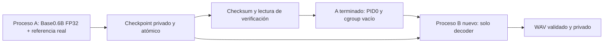

# Fase 7.4 — D-077: persistencia de códigos y decoder desacoplado

**Actualización vigente:** ensayo A→B real terminado, muestra10,8s y texto aceptados,
Voicebox productivo desplegado con supervisor dedicado. Ver [ejecución y producción
D077](PHASE7-D077-PRODUCTION.md). Narraciones55–60s siguen pendientes.

## Histórico: preparación anterior a la autorización de ejecución

El contenido siguiente acredita la preparación sin pesos; las prohibiciones y
pendientes de autorización de esa etapa fueron sustituidos por la aprobación
posterior registrada en DECISIONS. No describe el estado productivo actual.

Fecha: **11 de noviembre de 2026, Europe/Madrid**. Evidencias con sus marcas UTC.
Estado: **preparación y validación sin inferencia DONE; ensayo real TODO, sin autorizar**.
Fase 7.4 **IN PROGRESS**. No se cargaron pesos Qwen ni se generó audio en D077.
El objetivo final de WAV personal de55–60s sigue pendiente; esta preparación no
acredita mejora real de RAM, continuidad acústica ni aceptación de voz.

## Alcance y archivos

El propietario autoriza dos procesos independientes, checkpoint privado persistente,
soporte experimental120 y comprobaciones con datos sintéticos. No autoriza ahora
otro Talker ni decoder real. Se conservan los recursos: CT6273vCPU/10GiB RAM/2GiB
swap, worker hard9GiB y guarda CT9,5GiB; no cambios en Voicebox, otros LXC o pipeline.

Fuentes nuevas en [pilot-d077](../../services/infra-voicebox/pilot-d077/README.md):

| Archivo | Función |
| --- | --- |
| `checkpoint.py` | Escritura atómica, integridad, permisos, formato y recorte |
| `worker.py` | Talker A, decoder B, verificación sin pesos y etapas sintéticas |
| `runtime.py` | Versiones/fuentes fijadas, cabeceras y carga exclusiva del decoder |
| `guards.py` | Umbrales puros, probados en límites sintéticos |
| `supervise.py` | Exclusión, preflight, métricas externas y cancelación del worker propio |
| `prepare.py` | Preparación versionada e idempotente de fuentes/jobs privados en CT627 |
| `run.py` | Ejecución acotada por SSH estricto; plan por defecto |
| `trial.py` | Futuro A→B secuencial, presupuesto combinado900s, sin retry |
| `validation.py` | Layout meta, orden/contexto sintéticos y cargador con un peso ficticio |
| `README.md` | Procedimiento único del próximo ensayo y recuperación |

Pruebas nuevas: [test_d077.py](../../tests/voicebox/test_d077.py). Se actualizan
ROADMAP, CURRENT-STATUS, DECISIONS, fase07 e inventario627 con el resultado. No se
modifican Terraform, Compose productivo, imagen, modelos ni recursos en esta tarea.
No commit ni push; se preservan los cambios locales anteriores.

## Arquitectura implementada

A mantiene la API oficial `generate_voice_clone`, la preparación ICL con audio y
transcripción, el mismo texto D076, semilla42, FP32/CPU/SDPA, tres hilos e interop1,
max_new_tokens1024 y los parámetros de generación del snapshot. Intercepta la
frontera exacta `speech_tokenizer.decode`: verifica EOS final, la concatenación del
prefijo de referencia, persiste y lee el checkpoint, y sale mediante una señal
interna de finalización. **A nunca ejecuta el decoder**. Esta frontera está
implementada pero su recorrido con un modelo real sigue sin probar en D077.

El supervisor externo comprueba salida completa/PID0/cgroup vacío, retira solo el
contenedor que acaba de crear y escribe un release ligado al hash del manifest.
La exclusión con flock y la comprobación de workers/modelo productivo evitan dos
motores pesados simultáneos. B no arranca si falta release o su checksum no coincide.

B no monta `/cache` completo ni `/private`: recibe únicamente checkpoint, salida
del job y dos archivos del codec en solo lectura. Carga `Qwen3TTSTokenizerV2Decoder`
directamente, no `Qwen3TTSModel` ni `Qwen3TTSTokenizer` completo. Selecciona solo
las271 entradas `decoder.*` del archivo safetensors, con estado estricto y asignación
a parámetros inicialmente meta. Los buffers no persistentes se mantienen en CPU.
Las entradas ocupan457.292.548bytes (aprox.436MiB), **no es una medida del RSS de
inferencia**. No se construye encoder, Talker, speaker encoder ni processor en B.

La revisión del código confirma que el wrapper oficial concatena referencia+salida
antes de decodificar y recorta después. El manifest conserva ese split; B reproduce
el mismo `int(ref_frames / total_frames * samples)` después de limitar la salida
a `total_frames*1920`. Frecuencia24kHz, mono, PCM16. No se añade tempo, recorte de
contenido, silencio ni conversión ficticia para afirmar duración60s.

## Checkpoint y persistencia

Ubicación real prevista: `/srv/voicebox/pilot-d077/jobs/narracion01/checkpoint/`.
El job con texto está preparado; **ese checkpoint real todavía no existe**.
Directorio700, archivos600, UID999, en disco persistente del CT, fuera de Git.
`/tmp/numba` es solo caché efímera, nunca el destino de códigos.

| Artefacto | Contenido |
| --- | --- |
| `codes.npy` | Array int64 `[referencia+generación,16]`, sin pickle ni objetos |
| `manifest.json` | Shape/dtype/SHA256 de códigos, split, estrategia de recorte,24kHz/1920 |
| Metadatos del manifest | Modelo/snapshot, imagen/paquetes/fuentes, configuración codec, parámetros efectivos serializables y configuración de generación, semilla/hilos/EOS |
| Referencia en manifest | Códigos completos incluidos en el array; hash de audio y transcripción exacta, no audio ni transcripción en texto |
| `COMMITTED.json` | Esquema y SHA256 del manifest; se verifica también el payload |
| `talker-release.json`, fuera del checkpoint | PID0/cgroup vacío y hash del manifest; habilita B |

Commit: writer-lock exclusivo, directorio parcial privado en el mismo filesystem,
fsync de códigos/manifest/marcador, verificación por lectura, fsync del directorio,
renombrado atómico al destino y fsync del padre. Nunca sobrescribe checkpoints ni
textos previos. Si la escritura falla, no se publica el nombre final; los parciales
se conservan para inspección y no son candidatos automáticos de recuperación.

El lector acota tamaño, cabecera y dimensiones antes de reservar memoria; rechaza
pickle, shape/dtype incorrectos, valores fuera del codebook, falta de EOS, split
incoherente, permisos abiertos, symlinks de archivos y checksums divergentes.
El formato contiene información biométrica derivada: **no publicar los códigos**.

Persistencia en el CT no equivale a backup remoto. El diseño permite sobrevivir al
fallo/cancelación de B sin repetir A; una avería del disco exigiría una copia privada
externa, todavía no creada porque no existe un checkpoint real.

## Verificaciones realizadas

| Verificación | Evidencia y resultado |
| --- | --- |
| Sintaxis | `py_compile` de los9 scripts y del test: PASS |
| Pruebas locales | 17 tests PASS: integridad, parcial interrumpido, no overwrite, permisos/symlink, dimensiones/tipos/rangos/EOS, recorte, recuperación en proceso nuevo, guardas y planes sin ejecución |
| Escritura sintética CT627 | Contenedor independiente guardó checkpoint12×16 int64; terminó PID0 y se retiró |
| Recuperación sintética CT627 | Otro contenedor recuperó exactamente los códigos después de retirar al escritor; repetido con el lector actualizado: PASS |
| Imports reales | Numba0.60.0/librosa0.11.0, torch2.8.0+cpu, qwen-tts0.1.1, transformers4.57.3, accelerate1.12.0, safetensors0.8.0, numpy1.26.4: PASS |
| Layout decoder |271 entradas del estado coinciden en nombres y shapes con cabecera real; todos los tensores meta, cero pesos reales cargados y cero forward |
| Cargador desacoplado | Un parámetro ficticio verifica asignación meta→CPU y buffers no persistentes; el lector rechaza acceder a pesos encoder |
| Bloques300/120 | Marcadores sintéticos conservan orden y contexto25; PASS estructural, **no equivalencia acústica** |
| Cancelación | Worker sintético con padre+hijo; cgroup.kill,137 sin OOM, PID0, cgroup vacío y contenedor propio retirado |
| Preparación repetida | Misma revisión/hash/texto, `new_revision=false`, sin recrear ni recargar servicios |
| D076 recuperable | Inventario real de ambos jobs: solo texto, eventos, progreso y resultado parcial; ningún `.npy/.npz/.pt/.pth/.safetensors/.bin` de checkpoint ni WAV |

La prueba de imports/layout final empleó unos492MiB de RSS máximo. Es coste de
imports y validación meta, **no consumo del decoder cargado**. El primer intento de
imports falló por enlaces relativos HF al montar solo el subdirectorio; quedó
diagnosticado y corregido montando config y safetensors individualmente. La
validación posterior pasó. No se descargaron modelos ni se cargaron pesos para
resolverlo. Las revisiones de fuentes anteriores permanecen conservadas.

La transcripción del directorio privado D072 coincide por hash con el original
privado y la referencia confirmada de Voicebox (425caracteres). A comprueba también
ese hash, no solo longitud. La grabación normalizada mantiene SHA256
`7b388a917fb98bdf6b251454e04e7adc511faec42d21797f103ce539fc167dd4`.

## Decoder300 frente a120

Primero debe medirse **solo la separación A/B con300/context25**, como en D076.
La ausencia del Talker y encoder en B es una reducción justificada de componentes
residentes, pero **no se declara suficiente sin una medida real**. La caché del CT
puede seguir cargada después de terminar A; liberar un proceso no vacía memory.current.
No se purgan cachés ni se reinicia CT627 para fabricar margen.

120/context25 está implementado como opción experimental de B. Ambos usan el
método `chunked_decode` real del backend fijado, sin reescribir su algoritmo:
300pasos equivalen a24s,120 a9,6s y25 de contexto a2s, con upsample1920/24kHz.
La prueba de marcadores comprueba orden/solapamiento/longitud; convoluciones y
atención pueden producir diferencias en los bordes. Solo comparar WAV reales del
mismo checkpoint y escucha permitirá aceptar calidad y continuidad.

Si300 funciona, no ejecutar120 por defecto. Si300 falla, el checkpoint permite
proponer una prueba de B120 sin pagar otra vez los634s de Talker. No retry automático.

## Recuperación y próximo ensayo exacto

Seguir únicamente el [procedimiento versionado](../../services/infra-voicebox/pilot-d077/README.md#próximo-ensayo-propuesto--requiere-autorización-de-generación-real).
El plan propuesto `trial.py --job narracion01` **no ejecuta**; con aprobación futura,
`--execute` secuencia A y B300 con presupuesto combinado nominal900s y reserva de
arranque/cancelación. Si A falla, B no arranca. Si falta tiempo para B, conserva
checkpoint sin forzar el decoder. Los tiempos de transporte/cancelación requieren
medición real; no se presenta un SLA estricto extremo a extremo como ya probado.

En fallo de B: conservar checkpoint, manifest, hashes, eventos y métricas; verificar
PID0, RAM/CPU/swap/PSI y salud productiva. El próximo B puede leer el mismo checkpoint
en un contenedor nuevo, con un número de intento distinto. Nunca repetir A por un
fallo de B. Si A terminó después del commit pero antes de escribir release, la etapa
`verify` recupera/valida desde otro proceso sin pesos y registra release tras PID0.
Si falta commit/checksum válido, detenerse; no reconstruirlo editando metadatos.

Guardas conservadas: CT9,5GiB, worker8,2GiB con hard9GiB/sin swap, crecimiento
swapCT128MiB, techo absoluto1920MiB, PSIlocal5% sostenido10s; host disponible mínimo
4GiB y guarda combinada PSIhost20% con disponible<6GiB/10s. Preflight requiere12GiB
disponibles de host, swapCT<1792MiB, presión local<5%, disco>10GiB, recursos exactos,
Voiceboxhealthy/modelo no cargado y ausencia de otros Qwen. No se relajan umbrales.
Métricas externas: RSS muestreado, anon/file, cgroup, CPU, swap, PSI y OOM; RSSHWM
del worker si termina normalmente. Un SIGKILL puede impedir escribir su resultado;
el checkpoint ya committed y las medidas externas sobreviven.

## Conservación, riesgos y estado final

Se preservan perfiles, grabaciones, modelos, imágenes, backups y volúmenes. Voicebox
mantiene ID/imagen/inicio/restarts y health, las27 configuraciones PVE conservan sus
hashes, cero nuevos OOM en host/cgroups observados y ningún worker D077 activo.
Kokoro/Piper siguen disponibles como descargados; no se hizo síntesis funcional nueva.
Los exporters locales siguen respondiendo. La incidencia previa Prometheus9090 no
se interviene ni se presenta como resuelta; no se acredita una nueva cadena central.

Riesgos pendientes: recorrido real de la frontera A/checkpoint, asignación de pesos
reales del decoder, memoria máxima/latencia de B, continuidad/acento/fidelidad y
duración WAV. El archivo D076 era nominalmente812pasos≈64,96s; no cambiar el texto
ahora permite aislar la memoria. Una vez exista WAV, comprobar duración real antes
de plantear otro ajuste para55–60s. La caída de PVE/Docker exige auditar procesos
antes de reanudar; las señales normales sí recorren la cancelación controlada.

**Recomendación:** autorizar posteriormente un único ensayo A→B300 manteniendo
todos los límites; evaluar120 solo con checkpoint válido si la medición lo justifica.
Ahora se detiene la preparación: no ensayo real, no integración productiva, no commit/push.

## Evidencias

- [Preparación y hashes de fuentes](evidence/2026-11-11-d077-preparation.json).
- [Validaciones sintéticas e imports](evidence/2026-11-11-d077-validation.json).
- [Escritura sintética](evidence/2026-11-11-d077-synthetic-write.json).
- [Recuperación desde otro proceso](evidence/2026-11-11-d077-synthetic-read.json).
- [Cancelación padre+hijo](evidence/2026-11-11-d077-cancel.json).
- [Imports y layout meta](evidence/2026-11-11-d077-imports.json).
- [Estado final y conservación](evidence/2026-11-11-d077-final.json).

Los logs privados completos están fuera de Git. La evidencia pública contiene
metadatos de comprobación, no grabaciones, transcripciones ni códigos de voz reales.
