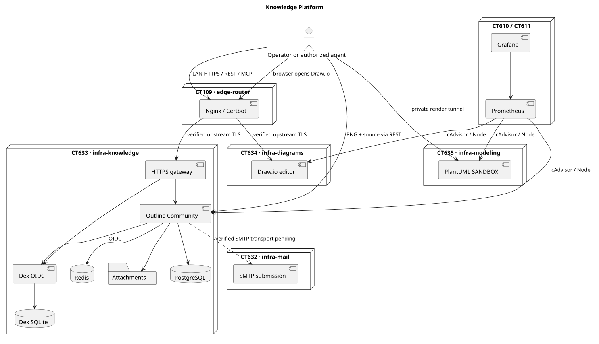

# Knowledge Platform — AI Agent Integration & Operations Guide

Start with the [quick start](knowledge-platform/QUICK-START.md) and [machine-readable deployment manifest](knowledge-platform/platform.json). The [operator runbook](KNOWLEDGE-PLATFORM.md) covers deployment, access, and recovery. Evidence is dated in the [implementation plan](../roadmap/planes/CT633-635-KNOWLEDGE-PLATFORM-PLAN.md).

## Architecture and current access



The [editable PlantUML source](knowledge-platform/architecture.puml) distinguishes active connections from pending integrations.

| CT | Service | Current verified access |
|---|---|---|
| 633 | Outline Community, Dex, Nginx, PostgreSQL and Redis | `https://infra-doc.mailerblend.com/home` from the LAN. The canonical origin is `https://infra-doc.mailerblend.com`. |
| 634 | Draw.io | `https://infra-diagrams.mailerblend.com/` through CT109 from the LAN. Native save, edit and reopen verified. |
| 635 | PlantUML Server | CT-local `http://127.0.0.1:8080`. Tunnel it to local port 18080. The SANDBOX profile rejects remote includes. |
| 632 | SMTP | STARTTLS submission on port 587. Outline integration remains pending certificate-verifying transport. |

The observed DHCP values in the manifest are evidence, subject to lease changes. CT109 terminates browser TLS with its existing certificate and forwards to the CT633 gateway over verified TLS. Both proxies forward WebSocket upgrades. Dex issues OIDC identities with separate administrator and agent accounts. PostgreSQL stores workspace content and metadata, the attachments volume stores uploaded bytes, Dex SQLite holds identity-provider state, and Redis holds application coordination and queued state. CT610 Prometheus collects Node Exporter and cAdvisor, and CT611 Grafana exposes Fleet and Details.

The Outline origin was verified through normal DNS. The native Draw.io integration opens a separate editor window at the HTTPS origin above. The browser must reach it independently of Outline. A browser test verified a second save and reopening the same diagram after restarting Draw.io. [Outline Diagrams.net settings](https://github.com/outline/outline/blob/v1.13.0/plugins/diagrams/client/Settings.tsx)

## REST API

Use POST requests to `${OUTLINE_URL}/api/<method>`. Obtain a dedicated key in Outline under **Settings → API keys**, using an agent account with access only to its assigned collection. Store the key in the approved secret manager and inject it as `OUTLINE_API_TOKEN`. Use a read key for browsing and a narrowly scoped publishing key for writes. Never include token values in command history, project files, logs, or workflow exports.

| Operation | Method | Minimum body |
|---|---|---|
| List collections | `collections.list` | `{}` |
| List documents | `documents.list` | `{"collectionId":"UUID"}` |
| Find a CT document | `documents.search` | `{"query":"CT618"}` |
| Read content and revision | `documents.info` | `{"id":"UUID"}` |
| Create a page | `documents.create` | Collection UUID, title, Markdown `text`, explicit `publish` |
| Update a specific passage | `documents.update` | UUID, last observed `lastRevision`, `editMode:"patch"`, unique `findText`, replacement `text` |
| Reserve an attachment | `attachments.create` | Document UUID, filename, media type and byte size |
| Fetch a private attachment | `attachments.redirect` | Attachment UUID, then follow only the verified origin |

For the local storage upload, POST the returned short-lived signed multipart form plus the file to the validated same-origin HTTPS upload URL. The API key is used for attachment creation and authenticated retrieval. The signed upload uses no bearer header. Read back the bytes and confirm the target document references the intended attachments. The tested [publisher](../../scripts/knowledge-platform/publish.py) implements that exchange. [Outline REST API](https://www.getoutline.com/developers)

Use the [Python example](knowledge-platform/outline-example.py) for read, create, search, and revision-guarded updates:

```bash
python3 docs/runbooks/knowledge-platform/outline-example.py collections
python3 docs/runbooks/knowledge-platform/outline-example.py search CT618
python3 docs/runbooks/knowledge-platform/outline-example.py read "$DOC_ID"
python3 docs/runbooks/knowledge-platform/outline-example.py create "$COLLECTION_ID" 'CT618 · infra-composable-crm' ./draft.md
python3 docs/runbooks/knowledge-platform/outline-example.py patch "$DOC_ID" "$DOC_REVISION" ./old-passage.md ./verified-passage.md
```

Search before create. Save the returned UUID in the task record. On a timeout after creation, search for the title and verify its collection and content before retrying.

## MCP

Use Streamable HTTP at `https://infra-doc.mailerblend.com/mcp` with a bearer key from the same workspace. The client must reach CT109 through the LAN or an approved private route. The verified read key negotiated `initialize` and returned the following through `tools/list`:

- `list_collections`, `list_documents`, `list_collection_documents`, `fetch`
- `list_comments`, `get_document_changes`, `list_templates`, `list_users`

The read key exposed no write tools. MCP write calls remain unverified. Use REST for create, guarded update, and publishing. Discover tools after connecting because the list depends on the key and version.

Example for a Codex client with private network access. Inject `OUTLINE_MCP_TOKEN` at runtime:

```toml
[mcp_servers.outline]
url = "https://infra-doc.mailerblend.com/mcp"
bearer_token_env_var = "OUTLINE_MCP_TOKEN"
```

For an MCP client with generic HTTP configuration, specify that URL, Streamable HTTP, and the bearer credential reference. A remote hosted agent needs an approved route to the private service. [Outline MCP documentation](https://docs.getoutline.com/s/guide/doc/mcp-6j9jtENNKL)

For n8n, run the workflow where it can resolve and reach Outline, with normal certificate validation in the execution environment. Use an HTTP Request node with a stored Header Auth credential and JSON body for REST. Keep the document UUID and expected revision as workflow items. Branch on 409 to read the document again and send it for review. Use the publisher in a controlled worker for rendering and signed multipart uploads. Keep authorization headers and attachment signatures out of execution logs.

## Render and publish a diagram

Use the same key for a diagram across successive versions. On the target page create two standalone paragraphs with a blank line between them:

```text
PlantUML begin: ct618-topology

PlantUML end: ct618-topology
```

The publisher requires exactly one pair of markers. It preserves all Markdown outside that block. Store the editable `.puml` in the repo and attach it to the document alongside the PNG.

```bash
encoded=$(python3 -c 'import sys; sys.path.insert(0,"scripts/knowledge-platform"); from publish import encode; print(encode(open(sys.argv[1],"rb").read()))' diagram.puml)
curl --fail --silent --show-error "$PLANTUML_URL/svg/$encoded" -o diagram.svg
python3 scripts/knowledge-platform/publish.py \
  --outline "$OUTLINE_URL" --renderer "$PLANTUML_URL" \
  --document "$DOC_ID" --diagram-key ct618-topology diagram.puml
```

A repeated source hash leaves the document and attachments unchanged. On an interrupted upload, an existing verified attachment can be reused by its deterministic ID. Stop if metadata exists but the content cannot be verified. Review the unattached record before retrying. A 409 means someone changed the document since it was read. Inspect the new revision before attempting another patch. The publisher checks the unchanged text outside the block and both attachment links after the update. Never switch to a full-page replacement after a conflict.

## Document an existing CT

For CT618, first resolve the VMID, name and documented IP from [canonical inventory](../../inventory/services/infra-composable-crm.yml). Follow the [LXC documentation workflow](LXC-DOCUMENTATION-PROCESS.md) for source files and read-only evidence. Use strict SSH and approved read paths. Gather resource values, service inventory, network paths and dependencies with timestamps. Omit credentials and full environment dumps.

Search Outline for `CT618`, select the canonical UUID in its project collection and read the current revision. Compare the existing content with observed evidence. Mark unverifiable fields as pending. Review the Markdown and diagram locally. Apply only the changed passage, publish the managed diagram by UUID, then read back the page and both attachments. Record the timestamp, source evidence, task, revision, and reviewer where required.

Use the title **CT<VMID> · <service-name>**. Within the project collection, place the CT overview above its nested runbooks and diagrams. Include purpose, technical specifications, architecture, networking, Docker services, storage and volumes, dependencies, security, monitoring, backup and recovery, troubleshooting, runbooks and change history. Link the canonical inventory, scoped runbooks and editable diagram source.

Use one workspace. Project names are a naming convention for native collections. Use nested documents for components and procedures. Preserve existing user content and collection permissions when organizing pages.
