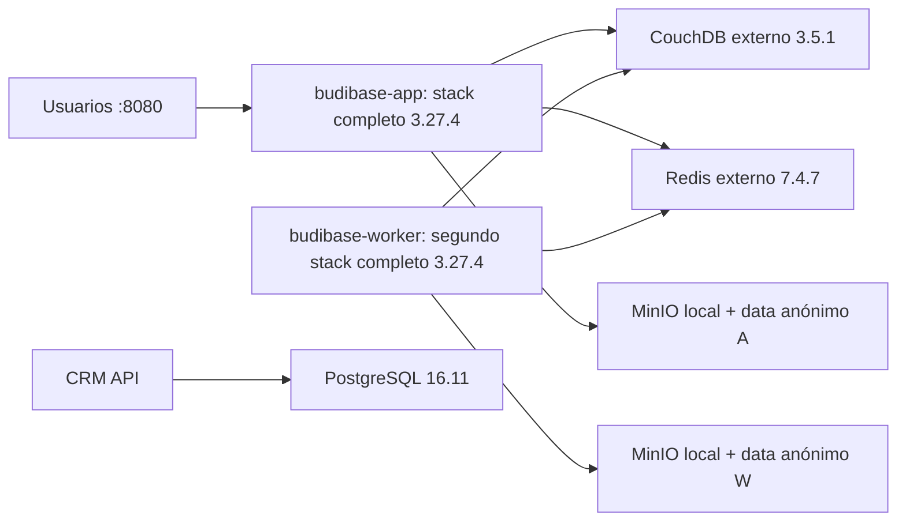

# CRM CT 618: recuperación conservadora

Aceptación central: **Fase 3 DONE — Accepted with UAT Waiver**, 2026-11-02.
Ver [DECISIONS](../../../docs/roadmap/DECISIONS.md), D-011. UAT manual no ejecutada
y dispensada por el propietario; no acredita todos los flujos funcionales.

Estado: recuperación autorizada y ejecutada el 2026-11-02. Véase
[PHASE2-EXECUTION.md](../../infra-prom/PHASE2-EXECUTION.md) para las evidencias,
los límites de las pruebas y las incidencias pendientes. Las mediciones siguientes
describen el diagnóstico previo; no representan el estado final.

## Causa raíz y arquitectura confirmada

El CT tiene 4 GiB de RAM y 512 MiB de swap. La medición anterior muestra ambos casi
agotados, PSI full alrededor de 90% y cinco OOM kill acumulados. Los dos principales
consumidores son stacks completos Budibase (~2,24 y ~1,51 GiB), no los exporters.
La falta de respuesta de SSH/HTTP es coherente con la reclamación extrema de memoria.
No se corrige subiendo el timeout de Prometheus ni reinstalando exporters.



Los endpoints efectivos se leyeron del entorno de los procesos, mostrando únicamente
host/puerto, sin credenciales: CouchDB `couchdb:5984`, Redis `redis:6379`, MinIO
`127.0.0.1:9000`. No hay una separación efectiva apps/worker mediante esas imágenes.

## Versiones e identidad inmutable

Ambas instancias ejecutan Budibase **3.27.4**, confirmada en los procesos y en la
configuración OCI de la imagen instalada. El package.json usa 0.0.0 y NO es la
versión efectiva. El contenido corresponde a:

- Índice: `budibase/budibase@sha256:5c5c995643132864ea017af2b838e35506b37977ea5c0f379c059d9cce1f0bfa`.
- Manifest amd64: `sha256:2a730deebc70382157f0fb2d17c4563cbd5b75f30502f4713a1537e08253f10a`.
- Fecha de construcción: 2026-02-06. El tag mutable latest no debe actualizarse.
- CouchDB interno del monolito: 3.3.3; CouchDB externo: **3.5.1**.
- Redis externo: 7.4.7; PostgreSQL externo: 16.11.

`plan.json` conserva los digests observados de las dependencias. Se verificarán otra
vez antes de aplicar. No copiar archivos CouchDB 3.5.1 al CouchDB interno 3.3.3:
eso sería un cambio/downgrade de motor no evaluado.

## Volúmenes y dependencias

Todos se ubican bajo `/var/lib/docker/volumes/<nombre>/_data` dentro del rootfs del CT.
No se observaron mountpoints Proxmox adicionales: rootfs de 50 GiB en local-lvm.

| Consumidor | Volumen existente | Contenido observado y clasificación |
|---|---|---|
| budibase-app /data | `e46a42860595945350aedd5d8e7d5e6707cf456e1bea801f246f63a7b0720aed` | .env de 64 bytes; couch con 6 archivos (~58 KB); minio con 132 archivos (~9,57 MB); redis/search/litellm vacíos. Preservar TODO: los objetos y configuración son persistentes. |
| budibase-worker /data | `52b4057040a96ca1a58d5d19fcf986c5a859376204c79e0bc4ae47bd78328697` | .env de 64 bytes; couch con 6 archivos (~58 KB); minio con 7 archivos (~14 KB); redis/search/litellm vacíos. Menor tamaño no demuestra que sea prescindible. |
| CouchDB externo | `budibase_couchdb_data` | 22 archivos, ~3,07 MB. Endpoint efectivo de las aplicaciones: datos/metadatos persistentes; backup obligatorio. |
| Redis externo | `budibase_redis_data` | RDB y AOF; ~46,7 MB. Puede contener colas/estado, no asumir que sea solo caché regenerable. |
| PostgreSQL | `supabase_postgres_data` | Datos del CRM. Se incluye aunque no sea el volumen /data de Budibase. |

Solo se leyeron estructura, tamaños, versiones y metadatos: no se exportaron registros,
objetos de usuario ni secretos. El CouchDB interno parece inicializado y los directorios
vacíos pueden ser regenerables, pero no se excluye nada del backup. La dependencia de
cada app con conexiones externas y el contenido lógico se comprobarán en una restauración
controlada. Los exports de apps Budibase no equivalen a una copia completa de usuarios,
permisos, datos y objetos.

## Elección de arquitectura

| Opción | Ventajas | Riesgos / coste |
|---|---|---|
| Recuperación conservadora: mantener UNA instancia completa instalada, con CouchDB/Redis externos existentes y MinIO integrado | Mismo software/datos/endpoints, reduce ~1,5 GiB de consumo observado; no obliga a migrar motores o objetos. | Conserva componentes internos redundantes; necesita prueba de capacidad y de automatizaciones con una sola instancia. |
| Topología oficial dividida: apps + worker dedicados + DB/Redis/MinIO/proxy | Roles explícitos y mejor control de recursos/escalado. | Migración de configuración, objetos, rutas y secretos; versiones compatibles y pruebas completas; más componentes. No copiar master actual sobre una instalación 3.27.4. |

Recomendación: primera opción para RECUPERAR, usando la imagen exacta 3.27.4 y el
volumen del app. Mantener el contenedor y volumen del duplicado intactos y detenidos
solo después de backup/validación. Evaluar la división como migración posterior.
No mezclar ambas instancias ni fusionar automáticamente sus directorios.

Referencias oficiales consultadas:
- https://github.com/Budibase/budibase/blob/master/hosting/single/README.md
- https://docs.budibase.com/docs/docker-compose
- https://docs.budibase.com/docs/server-migration

## RAM temporal: decisión separada dentro de la recuperación CRM

El nodo tiene ~15,5 GiB físicos y se observaron ~6,4 GiB disponibles. Es razonable
proponer temporalmente **6 GiB para CT 618** (+2 GiB) para recuperar respuesta y lograr
paradas/exports limpios. No es obligatorio si se logra quiescer sin ello.

Antes: repetir medición de MemAvailable y presión del nodo; reservar al menos 2 GiB
para el host además de los 2 GiB adicionales (MemAvailable >=4 GiB en ese instante).
No usar swap libre como sustituto de RAM. No cambiar swap/CPU/disco en este paso.

La propuesta original está en plan.json; el inventario activo ya declara 6144 MiB. Para reproducir el cambio, preparar
el cambio temporal de resources.memory de 4096 a 6144 en inventory/services/infra-composable-crm.yml
y revisar un plan Terraform acotado al recurso de ese servicio. Aplicar solo si el
plan contiene exclusivamente el cambio de RAM: hay otros cambios previos en el repo.
No ejecutar apply general. Revertir la RAM a 4096 también requiere validación de carga,
no un temporizador ni una reducción automática durante presión de memoria.

## Procedimiento propuesto, con puntos de parada

1. Revalidar CT, digests, nombres de volúmenes, estado OOM/PSI, archivos de secretos y
   capacidad de backup. Guardar metadatos sensibles en un bundle privado fuera de Git.
2. Elegir destino aprobado: `storage` es `/mnt/storage`, filesystem XFS en `/dev/sdb`,
   con ~1,45 TB disponibles. Evitar `local`, que tiene solo ~7,6 GB disponibles.
   Es otro disco del MISMO nodo: exigir además una segunda copia fuera del host.
3. Si no responde userspace, solicitar/aplicar la RAM temporal aprobada y verificar
   que baja PSI. Si no funciona, detenerse y revisar; no forzar kill/reboot por script.
4. Bloquear escrituras de aplicaciones y automatizaciones en una ventana aprobada.
   Parar ordenadamente todo CT 618 para una copia fría consistente. Si la parada
   no termina, no escalar a SIGKILL automáticamente. No crear backups de archivos
   de DB en caliente y calificarlos como consistentes.
5. Con el CT YA detenido: backup completo nativo Proxmox hacia storage, por ejemplo
   `vzdump 618 --mode stop --storage storage --compress zstd --remove 0`.
   Confirmar que continúa detenido. El backup completo conserva imágenes, secretos,
   metadata Docker, red, API, PostgreSQL y volúmenes; el bundle de datos no lo reemplaza.
6. Montar el rootfs detenido mediante el procedimiento aprobado de Proxmox y crear
   el bundle adicional de cinco volúmenes + configuración con el script versionado.
   No montar sobre una ruta ocupada ni arrancar el CT mientras se está copiando.
7. Verificar checksums, listado del archivo nativo y una restauración aislada. No
   publicar IP .118, no conectar el clon a producción y bloquear egress: conexiones,
   schedulers y automatizaciones podrían provocar escrituras/notificaciones externas.
   Si el ensayo usa el mismo nodo, mantener el original detenido y no arrancar
   original+clon de 6 GiB simultáneamente; reevaluar margen del host o usar otro nodo.
   Validar CouchDB, PostgreSQL y objetos con los motores originales; el checksum de
   un TAR no demuestra integridad lógica de una DB. Conservar ambos conjuntos de datos.
8. Solo tras superar esa puerta: arrancar el CT en la ventana aprobada y detener
   explícitamente `budibase-worker` mediante Docker, sin eliminar contenedor/volumen.
   Un profile Compose NO detiene un contenedor que ya está arrancado; se necesita
   ese paso explícito antes de continuar. Si vuelve a bloquearse, no forzar borrados.
9. Incorporar el overlay de recuperación y los nombres de volúmenes existentes. Validar
   el modelo y que el digest está disponible localmente. Actualizar solo budibase-app,
   sin dependencias, build, pull, renew-anon-volumes, remove-orphans ni down -v.
10. Probar login, permisos, apps existentes, lectura/escritura controlada, attachments,
    automatizaciones y API/PostgreSQL. Verificar exporters, RAM/swap/PSI/OOM antes de
    cerrar la ventana. Conservar el duplicado detenido para rollback.

Estos pasos se ejecutaron tras la autorización de Fase 2; conservar las puertas de
backup y restauración en cualquier repetición. La ampliación mediante el proveedor
Terraform reinició el CT: no asumir que un cambio de RAM es siempre en caliente.

## Bundle frío: código preparado

Requiere Python 3, GNU tar, root para preservar UID/GID/xattrs/ACL, y CT detenido.
El script NO para/arranca CT, NO monta discos, NO limpia ni cambia recursos.
Comandos de referencia para ejecutar SOLO después de aprobación, desde una copia
del repositorio en el nodo y con rootfs montado por el operador:

```bash
python3 scripts/crm-cold-backup.py plan
python3 scripts/crm-cold-backup.py backup --execute \
  --rootfs /var/lib/lxc/618/rootfs \
  --destination /mnt/storage/crm-recovery/FECHA/bundle
python3 scripts/crm-cold-backup.py verify --bundle /mnt/storage/crm-recovery/FECHA/bundle
python3 scripts/crm-cold-backup.py restore --execute \
  --bundle /mnt/storage/crm-recovery/FECHA/bundle \
  --destination /mnt/storage/crm-recovery/FECHA/isolated-restore
```

El script crea archivos TAR privados por volumen y configuración, preserva UID/GID,
modos, ACL y xattrs mediante GNU tar y genera manifest con SHA-256/tamaños. Rechaza
fuentes ausentes, destino dentro del rootfs, sobrescrituras, traversal, enlaces o
archivos especiales que requieran revisión. Un fallo deja el intento parcial para
inspección, sin borrar nada. Ejecutar de nuevo sobre un bundle completo solo verifica
el punto original: NO produce un backup actualizado; usar otro directorio fechado.

Los backups contienen secretos: permisos directorio 0700/archivos 0600, acceso
restringido y copia cifrada fuera del nodo. No subir a Git ni publicar logs de contenidos.
Retener backup pre-recuperación y segunda copia hasta aceptación explícita; no hay
purga automática preparada. Verificar el archivo nativo con zstd y tar y conservar
sumas fuera del bundle. La restauración real de CT se ensaya con otro VMID/red aislada,
no sobrescribiendo CT 618; la restauración del script es solo un staging vacío.

## IaC preparada

- `plan.json`: identidad observada, cinco volúmenes, imagen y propuesta de RAM aplicada.
- `docker-compose.recovery.yml`: overlay que conserva volúmenes externos existentes,
  fija Budibase por digest y prohíbe pull. El worker queda en profile de legado.
- `recovery.env.example`: nombres no secretos; recovery.env real está ignorado.
- `scripts/crm-cold-backup.py`: plan/backup frío/verificación/restauración a staging.
- `scripts/validate-crm-recovery.py`: rechaza volúmenes intercambiados y digests distintos
  del plan revisado antes de intentar cualquier despliegue.
- `tests/monitoring/test_crm_recovery.py`: roundtrip, corrupción, permisos, no overwrite,
  traversal y guardas de escritura.

El up-budibase.sh normal continúa bloqueando la topología heredada; no se elimina
esa protección. El overlay debe aplicarse en el flujo especial aprobado, con los
secretos originales y recovery.env. Después del cambio, volver a validar la topología
canónica antes de retirar el overlay. No se cambió ningún archivo de secretos real.

## Tiempos, aceptación y rollback

Reservar inicialmente **30–90 minutos** de ventana CRM; no es una garantía. El bundle
pequeño de datos puede tardar segundos/minutos, pero backup completo, export de imágenes,
paradas, restauración y comprobaciones dominan el tiempo. Medir throughput/rehearsal
antes de fijar RTO. Si la parada o la restauración fallan, prolongar ventana o abortar.
RPO objetivo: punto de parada consistente, sujeto a la verificación de integridad;
no se asegura que OOM anteriores no hayan afectado datos.

Aceptación: ambos backups íntegros y segunda copia; restauración aislada funcional;
imagen exacta sin upgrades; ambos /data preservados; único stack principal activo;
login/objetos/DB/API correctos; exporters up durante >=10 minutos; PSI full <5% como
objetivo inicial, memoria con margen (>20%), swap sin crecimiento sostenido y contador
OOM sin incremento. Comparar líneas base y carga; no inferir recursos LXC desde las
métricas Node Exporter aún cuestionadas. Segunda aplicación sin recreación/recarga extra.

Rollback: parar escrituras, guardar un NUEVO backup del estado posterior, volver al
Compose/imagen/secretos originales y sus volúmenes preservados. No arrancar otra vez
ambos monolitos dentro de 4 GiB sin resolver la capacidad: repetiría la causa raíz.
Si la reversión necesita datos del punto frío, restaurarlos en volúmenes NUEVOS y
validar primero; no sobrescribir los originales. Restaurar conjuntamente DB, objetos,
claves y colas del mismo punto para evitar referencias rotas o tareas duplicadas.
No reactivar el worker hasta revisar efectos externos y capacidad. La reversión de
RAM es otra decisión aprobada tras observar carga estable.

## Aplicación reproducible sin eliminar contenedores

Usar `scripts/apply-crm-preserving-recovery.sh`, no un `compose up` genérico del
proyecto heredado. El helper exige un registro privado con `backup_verified`,
`offhost_verified` y `restore_verified` verdaderos, detiene sin SIGKILL el duplicado,
renombra el app original como `budibase-app-pre-recovery` y crea el reemplazo en el
proyecto separado `budibase-recovery`. Ambos originales se conservan detenidos.
El volumen /data del app es exactamente el original; no se fusiona el del worker.

Dentro de CRM, con los archivos revisados instalados y desde la ventana autorizada:

```bash
bash /tmp/apply-crm-preserving-recovery.sh --execute \
  /tmp/verified-recovery.json /opt/infra-composable-crm/budibase
```

La ruta de Compose real debe comprobarse antes de repetir; el registro no sustituye
las evidencias archivadas. Una segunda ejecución idéntica conserva ID/StartedAt.
Si cambia el hash de configuración, el helper se detiene antes de una recreación
implícita. No activar el profile legacy ni ejecutar el despliegue genérico anterior.

El cambio de memoria utiliza `recovery/memory.tfvars.json`, que conserva las etiquetas
existentes mediante `recovery_preserve_service_tags`. Revisar un plan dirigido al CT
618 y aplicar solo el cambio de RAM; no aplicar el resto del inventario pendiente.
No reducir automáticamente la memoria tras la recuperación.

### Rollback de configuración sin borrar datos

Con una ventana aprobada, detener limpiamente el nuevo `budibase-app`, renombrarlo
con un nombre de rollback libre y devolver `budibase-app-pre-recovery` a
`budibase-app`; iniciar ese original con el mismo volumen. Mantener el worker parado
hasta verificar capacidad y efectos externos. Nunca iniciar simultáneamente dos
apps sobre el mismo /data. No ejecutar `down`, `rm`, `--remove-orphans` ni recuperar
un backup antiguo sobre bases vivas. Si se sospecha corrupción, restaurar el conjunto
completo en otro CT aislado y decidir explícitamente qué punto de datos aceptar.
